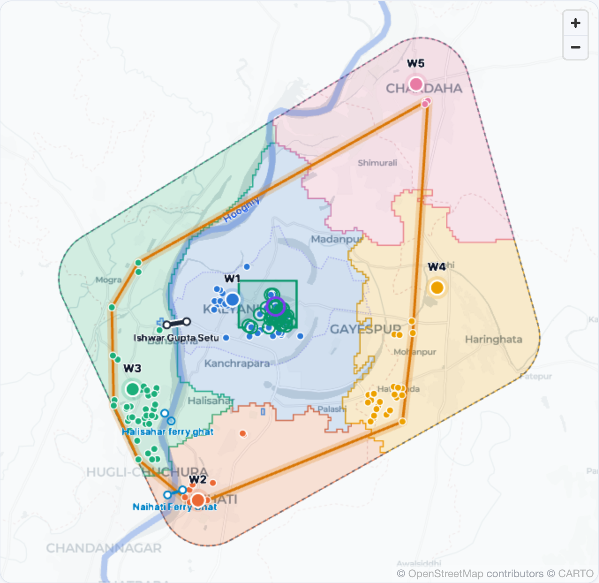
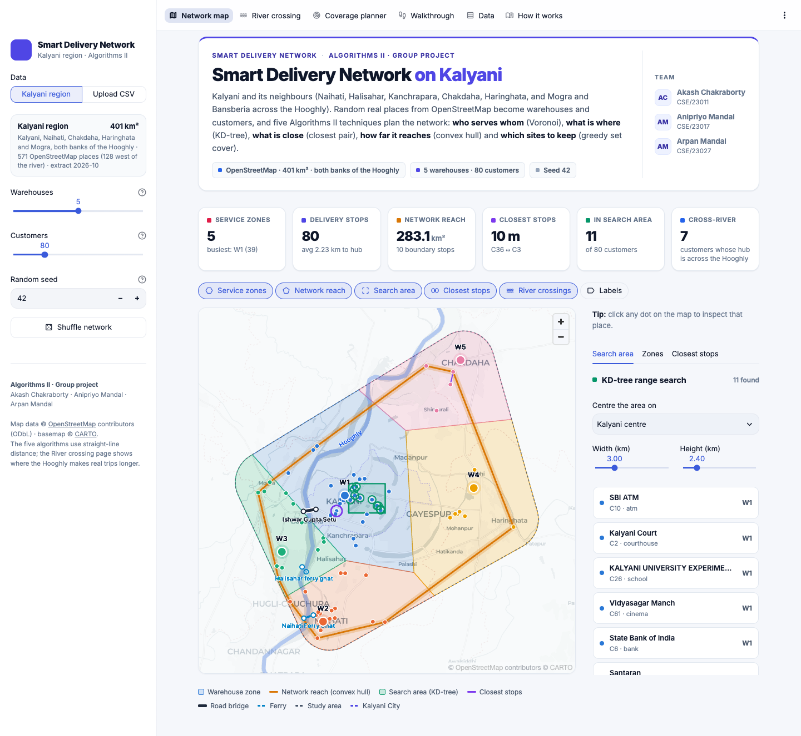
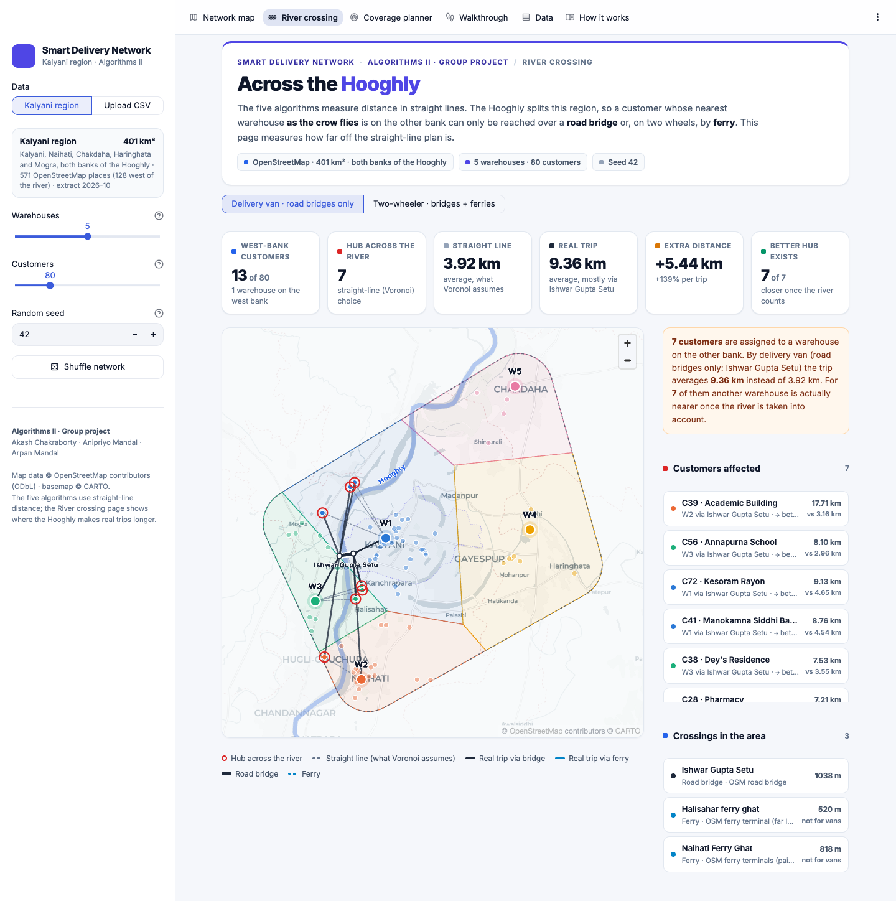
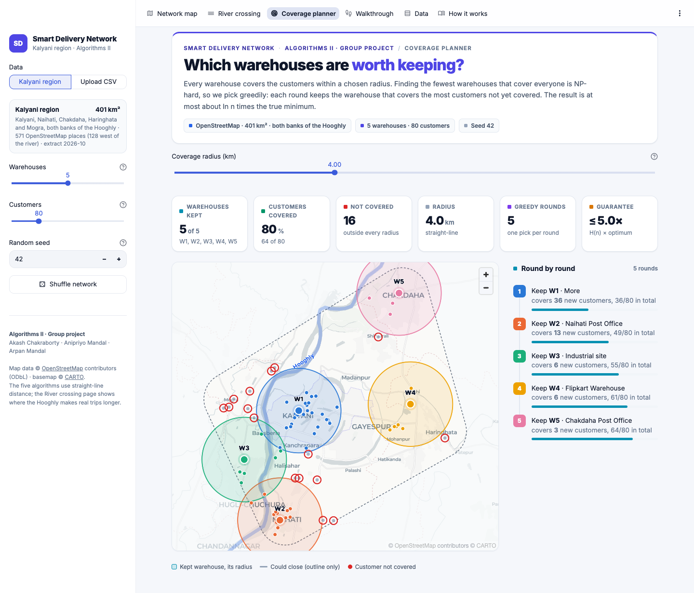
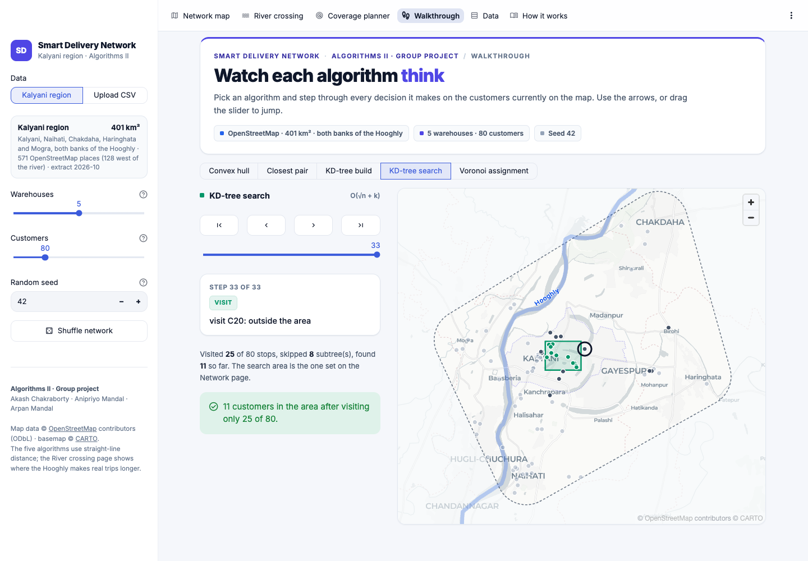

# Smart Delivery Network on Kalyani

**Algorithms II · Group project.** Akash Chakraborty (CSE/23011) · Anipriyo Mandal (CSE/23017) · Arpan Mandal (CSE/23027)

**Live app.** [smart-delivery-network.streamlit.app](https://smart-delivery-network.streamlit.app) (Streamlit Community Cloud, no installation needed)

**Report (PDF).** [report/Smart_Delivery_Network_Report.pdf](report/Smart_Delivery_Network_Report.pdf)



A geometric decision-support dashboard for deliveries around **Kalyani, West
Bengal**. The study area covers about 400 km² and reaches Naihati, Chakdaha,
Haringhata and, across the Hooghly, Mogra and Bansberia.

Random real places from **OpenStreetMap** become warehouses and customers
(up to 1,000 customers, mostly real homes from the OSM building footprints).
Five Algorithms II techniques then plan the network:

- Voronoi decides who serves whom.
- A KD-tree finds what is where.
- Closest pair finds what is near.
- The convex hull shows how far the network reaches.
- Greedy set cover picks the sites worth keeping.

Distances follow the **real road network** (121,678 OSM road nodes, Dijkstra).
The Voronoi service zones are computed by road distance (a network Voronoi
diagram), so each part of the area belongs to the warehouse nearest **by
road**, and coverage is measured along the roads too. The roads are used for
the calculations only; a sidebar switch draws the road paths if wanted. A **river check** shows where straight-line
planning breaks: customers whose nearest warehouse is across the Hooghly can
only be reached over **Ishwar Gupta Setu** or, on two wheels, by **ferry**.

The **Route planner** answers "product X is needed at these places, which way
should the rider go?". It picks a warehouse that stocks the product, finds the
fastest road route through every stop (exact Held-Karp order up to 10 stops,
nearest neighbour + 2-opt above), draws it on the map with an itinerary and
ETAs, and simulates the rider's progress.

It is a decision-support tool, not a navigation app: there is no live traffic,
fuel or driver scheduling.

<table>
  <tr>
    <td width="50%"></td>
    <td width="50%"></td>
  </tr>
  <tr>
    <td align="center"><b>Network map</b>, all five algorithms on one map</td>
    <td align="center"><b>River crossing</b>, real trips over the bridge or ferry against straight lines</td>
  </tr>
  <tr>
    <td width="50%"></td>
    <td width="50%"></td>
  </tr>
  <tr>
    <td align="center"><b>Coverage planner</b>, greedy set cover round by round</td>
    <td align="center"><b>Walkthrough</b>, every step of each algorithm (here the KD-tree search)</td>
  </tr>
</table>

The full write-up is in [`report/Smart_Delivery_Network_Report.pdf`](report/Smart_Delivery_Network_Report.pdf).

## Run

The app runs online at [smart-delivery-network.streamlit.app](https://smart-delivery-network.streamlit.app). To run it locally instead:

```
pip install -r requirements.txt
streamlit run app.py
```

On the project Mac the shared venv already has everything:

```
~/.venvs/analysis/bin/streamlit run app.py
```

The OpenStreetMap extract is saved in `data/`, so the algorithms work offline;
only the background street-map tiles need internet.

## Test

```
pytest tests/ -v
```

## Pages

| Page | What it shows |
|---|---|
| Network map | Voronoi service zones by road distance (the classic straight-line Voronoi can be overlaid for comparison), convex hull (network reach), KD-tree search area, closest stops (region-wide and per zone), the Hooghly with its bridge and ferries. Click any dot to inspect it. |
| Route planner | Pick a product and one or more delivery places (from the list, at random, or by clicking the map). The fastest road route from a warehouse that stocks it, with stop order, itinerary, ETAs and a live-tracking slider. |
| River crossing | Customers whose straight-line warehouse is on the other bank; the real road trip via the bridge (van) or bridge + ferry (two-wheeler); the extra distance; and the hub that is really nearest by road. |
| Coverage planner | Greedy set cover: which warehouses to keep for a given road distance, round by round, with the area each kept warehouse reaches by road. |
| Walkthrough | Step through every decision of each algorithm on the current map. |
| Data | The full point set with zones, banks and distances; CSV download. |
| How it works | The algorithms, the OSM pipeline, scope and limits. |

## Structure

- `src/convex_hull.py`: Andrew's monotone chain (a Graham-scan variant)
- `src/closest_pair.py`: divide and conquer
- `src/kdtree.py`: 2D KD-tree with rectangle range search
- `src/voronoi.py`: nearest-warehouse assignment and service zones clipped to the study area
- `src/set_cover.py`: greedy set cover (optional extension), ln n approximation
- `src/river.py`: river banks, trips via bridges/ferries, the river check
- `src/roads.py`: the OSM road graph, Dijkstra, snapping places to roads, Voronoi zones by road distance, and the route planner (Held-Karp, nearest neighbour + 2-opt)
- `src/traces.py`: instrumented copies of the algorithms for the Walkthrough page
- `src/geo.py`: study area, places, river, crossings, and the lat/lon → flat km projection
- `src/data.py`: random sampling of real places, CSV import/export
- `ui/`: Streamlit pages, deck.gl map layers and styling; the theme is in `.streamlit/config.toml`
- `scripts/fetch_osm.py`: downloads the OSM extract into `data/<YYYY-MM>/`
- `tests/`: every algorithm checked against a brute-force reference, plus geography, data, river and routing tests
- `report/`: written report, the scripts that produce its numbers and screenshots, and the project overview document it started from

## Data

`data/2026-10/` holds the extract the app uses (fetched 22 Oct 2026, roads and
buildings added 26 Oct 2026): 9,422 places (571 named places and 8,851
buildings), the drivable road network, the Hooghly's main channel, and 3
crossings (Ishwar Gupta Setu, Naihati ferry, Halisahar ferry). See `data/README.md` for every file. To
refresh it (needs internet):

```
python scripts/fetch_osm.py
```

OpenStreetMap maps few ferry ghats here. Add ones you know to
`data/manual/ferries.csv` (`name,lat_a,lon_a,lat_b,lon_b,note`).

Map data © OpenStreetMap contributors (ODbL). Basemap © CARTO.

## CSV upload format

Any city works: the flat km grid is centred on the uploaded points. Upload up to
8 warehouses. Uploaded networks have no river or road network, so distances
are straight lines and the River crossing and Route planner pages are skipped.

```
type,name,lat,lon
warehouse,Market No. 1,22.97600,88.44356
customer,Cafe Adda,22.97369,88.43705
```
