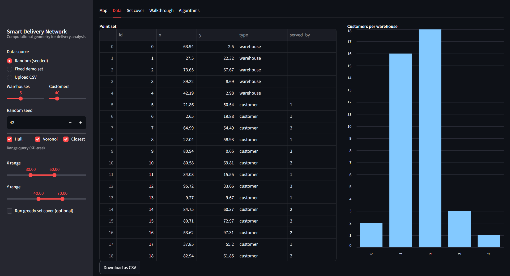
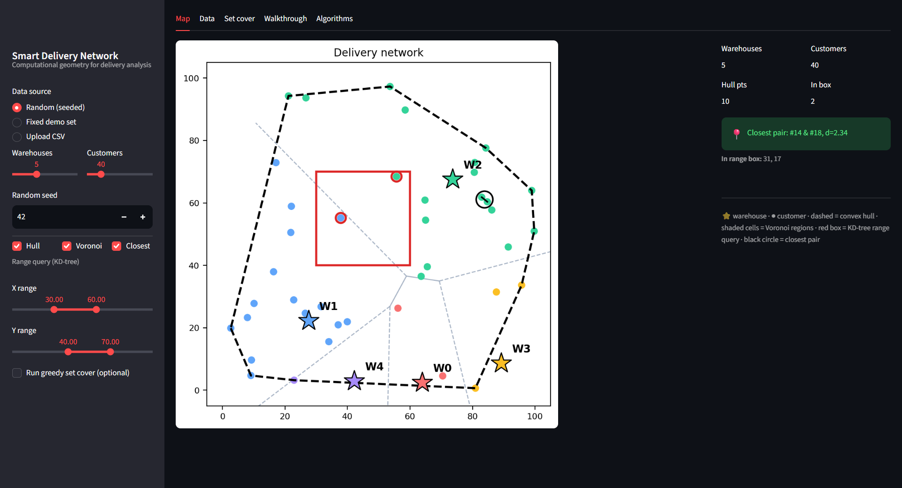

# Smart Delivery & Logistics Network

**Algorithms II (CSC711) — Mini Project Report**

Akash Chakraborty (Reg. 1059, Roll CSE/23011) · Anipriyo Mandal (Reg. 1065, Roll CSE/23017) · Arpan Mandal (Reg. 1075, Roll CSE/23027)

---

## 1. Problem Statement

A delivery company runs several warehouses and serves hundreds of customer stops.
Once the list of stops grows past what a person can eyeball, four questions become
hard to answer by hand:

1. Which warehouse should serve which customers?
2. Which stops sit close enough together to be worth grouping?
3. Which customers lie inside a given area (e.g. a planned delivery zone)?
4. How far does the network actually reach, and which sites are worth keeping?

Answering these by comparing every point against every other point takes
quadratic time and stops being practical once the stop count grows. Each
question is a textbook computational-geometry problem, so each is handed to
the algorithm built for it, and the results feed one dashboard.

This is a **geometric decision-support tool**, not a full vehicle-routing
system: it does not plan turn-by-turn routes, model traffic or fuel, or
schedule drivers.

## 2. Input Model

Every warehouse and customer is a point `(id, x, y, type)` on a 2D plane,
`type ∈ {warehouse, customer}`. Input can be generated randomly with a fixed
seed, loaded from a small hand-built demo set, or supplied as a CSV file with
columns `id,x,y,type`.

## 3. Algorithms Used

| # | Algorithm | Question Answered | Technique | Complexity |
|---|-----------|--------------------|-----------|------------|
| 1 | Convex hull (Graham scan) | How far does the network reach? | Sort points by (x, y), build the lower and upper chains by popping any point that makes a non-left turn | O(n log n) |
| 2 | Closest pair (divide and conquer) | Which two stops are nearest each other? | Split by x-median, recurse on both halves, then scan only the thin strip around the dividing line for a closer cross-pair | O(n log n) vs. O(n²) brute force |
| 3 | KD-tree + range search | Which customers lie inside this rectangle? | Build a binary tree over customers alternating x/y splits; a range query prunes whole subtrees that cannot intersect the query box | Build O(n log n), query O(√n + k) |
| 4 | Voronoi diagram | Which warehouse is nearest to each part of the plane? | Partition the plane into warehouse cells; every customer is assigned to its nearest warehouse (equivalent to falling inside that warehouse's cell) | O(m log m) for m warehouses |
| 5 | Greedy set cover (optional) | Which few warehouses cover the most demand? | Each candidate warehouse covers customers within a fixed radius; repeatedly pick the warehouse covering the most still-uncovered customers | NP-hard optimum; greedy gives an H(n) ≈ ln n approximation |

### 3.1 Convex Hull — Graham Scan

Points are sorted by `(x, y)`. Two monotone chains (lower and upper) are built
by scanning the sorted points once each, popping the last point from the
chain whenever it does not form a left (counter-clockwise) turn with the next
candidate. Concatenating the two chains gives the hull in counter-clockwise
order. Each point is pushed and popped at most once, so the scan is linear
after the O(n log n) sort.

### 3.2 Closest Pair — Divide and Conquer

The point set is sorted by x and split at the median into two halves. Each
half is solved recursively; let `δ` be the smaller of the two halves' best
distances. Any closer pair must have both points within `δ` of the dividing
vertical line, so only that thin strip is re-examined, sorted by y, and each
point is compared against at most the next few points in y-order (a classical
geometric packing argument bounds this to a constant). This avoids the O(n²)
cost of comparing every pair directly.

### 3.3 KD-Tree and Range Search

A KD-tree is built by recursively splitting the customer set on the median x
(even depth) or median y (odd depth), giving an O(n log n) build and a
balanced tree of depth O(log n). A rectangle range query recurses from the
root: if the splitting line does not intersect the query box's range on that
axis, the corresponding subtree is skipped entirely. This lets a query touch
only the points near the box boundary plus the points it reports, rather than
scanning every customer.

### 3.4 Voronoi Diagram

Each warehouse owns a cell of the plane: the set of points closer to it than
to any other warehouse. The cell boundaries are computed from the warehouse
sites to render the service-area map; assigning each customer to a warehouse
is done directly by nearest-site comparison, which by definition matches
whichever Voronoi cell the customer falls inside. The map makes visible which
warehouse serves which area, including irregular or distant stops.

### 3.5 Greedy Set Cover

Given a set of candidate warehouse sites and a coverage radius, each
candidate covers the customers within that radius. The true minimum number
of sites needed to cover every customer is an NP-hard set-cover instance, so
a greedy heuristic is used instead: repeatedly pick the candidate covering
the most still-uncovered customers, until every customer is covered (or no
candidate can help further). This greedy rule is proven to be within a factor
of `H(n) = 1 + 1/2 + ... + 1/n ≈ ln(n)` of the true optimum.

## 4. How the Algorithms Combine

- **Voronoi + KD-tree.** Voronoi decides which warehouse owns each customer.
  The KD-tree then pulls out the customers inside any rectangle drawn on the
  map, and their warehouse labels come along for free, so one query answers
  both "who is here" and "who serves them."
- **Voronoi + closest pair.** Closest pair can be restricted to one
  warehouse's region to find stops worth grouping into a shared delivery. This
  is explicitly proximity analysis only — it does not solve routing.
- **Convex hull + everything.** The hull marks the outer edge of the customer
  set, showing how far the network reaches and which warehouses sit far
  from their own service boundary.

## 5. Dashboard

An interactive Streamlit dashboard ties all five algorithms together:

- **Load data** — seeded random generation, a fixed demo layout, or CSV upload.
- **Show network** — scatter plot of all warehouses (stars) and customers,
  colour-coded by assigned warehouse.
- **Convex hull** — toggled dashed boundary overlay.
- **Voronoi** — toggled service-region overlay.
- **Range search** — sliders define a query rectangle; matching customers are
  highlighted and listed.
- **Closest pair** — nearest two customers are circled and reported with exact
  distance.
- **Coverage** — greedy set cover panel, with a radius slider and a
  round-by-round log of which warehouse was picked and how many new
  customers it covered.
- **Summary** — live counts (warehouses, customers, hull size, customers per
  warehouse) and a CSV export of the current point set.

## 6. Input / Output Example (fixed demo set)

Input: 5 warehouses, 30 customers (fixed coordinates, see `src/data.py::demo_set`).

| Step | Input | Output |
|------|-------|--------|
| Convex hull | 30 customer points | Boundary polygon of the outermost points |
| Voronoi | 5 warehouse sites | 5 service regions; every customer labelled with its nearest warehouse |
| KD-tree range query | Box x:[30,60], y:[40,70] | Customers whose coordinates fall inside the box, without scanning all 30 |
| Closest pair | All 30 customers | One pair and their exact Euclidean distance |
| Greedy set cover | 5 candidate warehouses, radius r | A minimal-effort subset of warehouses covering all customers within r |

Exact counts depend on the radius and box chosen interactively in the
dashboard; the algorithms themselves are deterministic given fixed input.

### Screenshot: input point set and served_by assignment (Data tab)

### Screenshot: combined output on the network map (Map tab)

## 7. Testing

Each algorithm is unit-tested against a brute-force reference implementation
(`tests/test_algorithms.py`):

- Closest pair is checked against an O(n²) pairwise scan over multiple random
  seeds.
- Convex hull is checked on a known square (interior points excluded) and on
  a fully collinear point set (degenerate case).
- KD-tree range queries are checked against a brute-force filter over random
  point sets.
- Greedy set cover is checked to fully cover a solvable instance.

All tests pass (`pytest tests/ -v`).

## 8. Discussion

### Limitations

- Euclidean (straight-line) distance stands in for road distance; the plane
  is flat with no obstacles, one-way streets, or traffic.
- The system does not plan a route — it identifies structure (who serves
  whom, who is nearby, how far the network reaches) rather than an ordered
  path for a vehicle to drive.
- Greedy set cover gives an approximate, not optimal, warehouse subset; for
  small instances an exact solver could be used instead.
- Voronoi cell geometry assumes it is only used for visualisation; the
  authoritative customer-to-warehouse assignment is computed directly by
  nearest-distance comparison, so rendering edge cases cannot affect it.

### Future Scope

- Replace Euclidean distance with real road-network distance (e.g. via a
  routing API) once GPS data is available, since the point model
  `(id, x, y, type)` generalises directly to real coordinates.
- Extend from static demand (all customers must always be served) to
  **capacitated** facility assignment, where each warehouse has a maximum
  number of customers it can serve.
- Combine the Voronoi/KD-tree layer with an actual routing stage (e.g.
  nearest-neighbour or 2-opt TSP heuristics) per warehouse region, to turn the
  decision-support output into drivable routes.

## 9. Conclusion

Voronoi decides who serves whom, the KD-tree finds what is where, closest
pair finds what is near, the convex hull shows how far the network reaches,
and greedy set cover picks the sites worth keeping. Together they turn a set
of raw warehouse and customer coordinates into an interactive, geometrically
grounded view of the delivery network, each piece solved by the
Algorithms II technique it fits.
